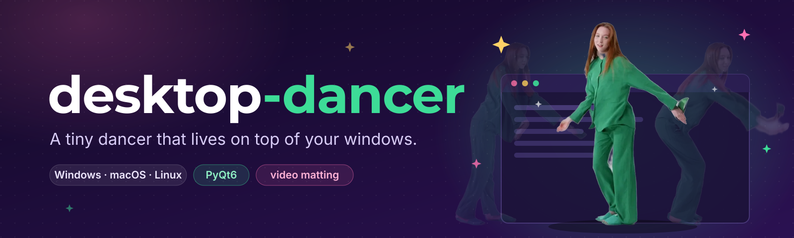
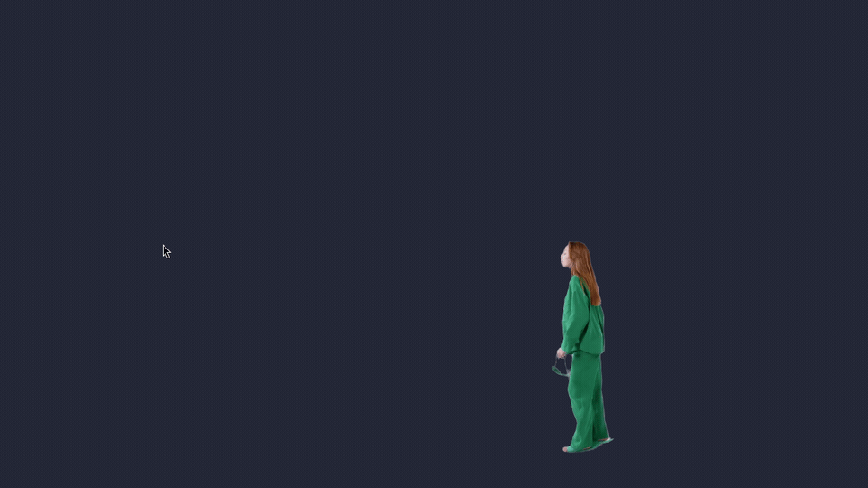
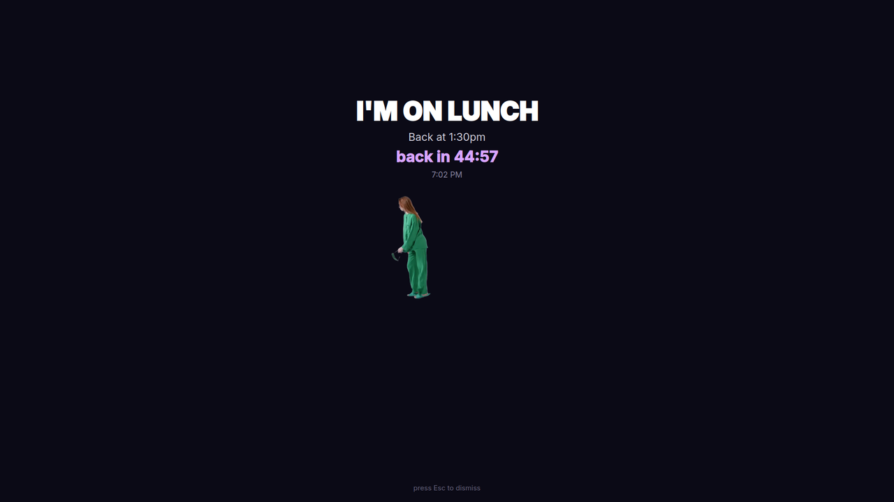
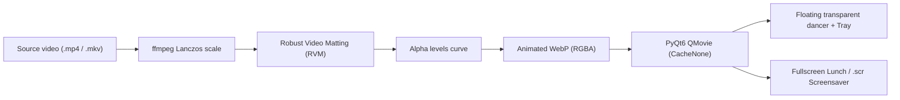

<div align="center">
  

  <br/>

  
  <a href="https://github.com/gabeparra/desktop-dancer-app/releases/latest"></a>
  
  
  <a href="./LICENSE"></a>
</div>

# desktop-dancer

> A real dancer, background removed, looping transparently on top of your windows. Step away and she turns into a fullscreen "I'M ON LUNCH" away screen or Windows screensaver.

**Status:** `Maintained` - cross-platform PyQt6 desktop companion and fullscreen lunch screen with local video matting.

## Demo

<p align="center">
  
</p>

<p align="center">
  
</p>

## Quickstart

### Prerequisites
- **Windows (prebuilt):** nothing to install. Grab `desktop-dancer.exe` (or `desktop-dancer.scr` for screensaver mode) from the [latest release](https://github.com/gabeparra/desktop-dancer-app/releases/latest).
- **macOS / Linux / from source:** Python 3.10+ and PyQt6.
- **Custom clip matting (optional):** `ffmpeg`, `torch`, `torchvision`, and `numpy` (CUDA, Apple Silicon MPS, or CPU).

### Setup & Run

```bash
git clone https://github.com/gabeparra/desktop-dancer-app.git
cd desktop-dancer-app
pip install -e .
desktop-dancer
```

Or run directly without installing the package:

```bash
pip install PyQt6
python desktop_dancer.py
```

Run the test suite:

```bash
pip install -e ".[dev]"
QT_QPA_PLATFORM=offscreen pytest -v
```

### Controls & Modes

The app starts with the bundled example dancer in the corner of your screen. Right-click (or drag and drop an animated WebP/GIF onto her) and pick **Change clip...** to use your own. Your chosen clip, size, and window position are remembered between launches.

| Action | Control |
|---|---|
| Move | Left-click and drag (uses compositor `startSystemMove()` on Wayland) |
| Resize | Mouse wheel (or tray **Resize** presets from 25% to 150%) |
| Context menu | Right-click or click the system tray icon |
| Pause / resume | `Space` (or tray **Pause**) |
| Click-through | Middle-click (when a system tray is available to toggle it back) |
| Swap clip | Drag and drop any animated `.webp` or `.gif` onto the dancer |
| Quit | `Ctrl+Q` or tray **Quit** |

**Fullscreen lunch mode:**

```bash
desktop-dancer --lunch "Back at 1:30pm"                  # default 1h countdown
desktop-dancer --lunch "Back at 1:30pm" --timer 45m      # custom countdown
desktop-dancer --lunch "AFK" --title "BRB" --timer 0     # hide countdown
```

You can also trigger lunch mode from the tray menu (**Go on lunch...**) or install `desktop-dancer.scr` on Windows as a native screensaver (`/s`, `/c`, `/p:HWND`). Press `Esc` (or move the mouse in `/s` mode) to dismiss.

## Stack & Architecture

- **Stack:** Python 3.10+, PyQt6 (`QMovie` with `CacheNone` frame streaming), PyTorch + [Robust Video Matting](https://github.com/PeterL1n/RobustVideoMatting), `ffmpeg`, PyInstaller, `pytest`.



- **Overview:**
  - `desktop_dancer.py`: PyQt6 frameless translucent window, `CacheNone` frame streaming (~6 MB RAM instead of caching hundreds of decoded RGBA frames), Wayland-safe drag, system tray controller, fullscreen `LunchOverlay`, and Windows `.scr` flags.
  - `rvm_to_webp.py`: offline matting CLI that decodes and scales video through `ffmpeg`, predicts per-frame alpha with RVM, snaps mid-alpha values with a levels curve so the dancer stays solid while hair stays soft, and encodes looping animated WebP.
  - `pajama_dance.webp`: bundled Pexels example clip so the app works right out of the box.
  - `desktop_dancer.spec` & `.github/workflows/`: PyInstaller one-file Windows `.exe`/`.scr` build plus Linux and Windows CI checks.
  - `tests/`: headless `pytest` suite covering playback, lunch layout sizing, CLI parsing, and matting pipeline commands.

## Bring your own dancer

Any animated WebP or GIF works out of the box:

```bash
desktop-dancer my_dance.webp
```

To cut a transparent WebP from a video you shot or have the rights to:

```bash
pip install -e ".[matting]"
python rvm_to_webp.py source.mp4 my_dance.webp 1280 720 25 0 15
```

Arguments are `<src> <dst> <width> <height> <fps> <start_sec> <duration_sec>`. Input video is scaled automatically with Lanczos, and `--device` defaults to `auto` (`cuda`, `mps`, or `cpu`). For cleaner edges on tricky backgrounds, add `--backbone resnet50`, or tune `--alpha-low` and `--alpha-high` if the cutout looks see-through or blocky.

## License

MIT - see [LICENSE](./LICENSE). Third-party clip credits are in [NOTICE](./NOTICE). Release history is in [CHANGELOG.md](./CHANGELOG.md).
